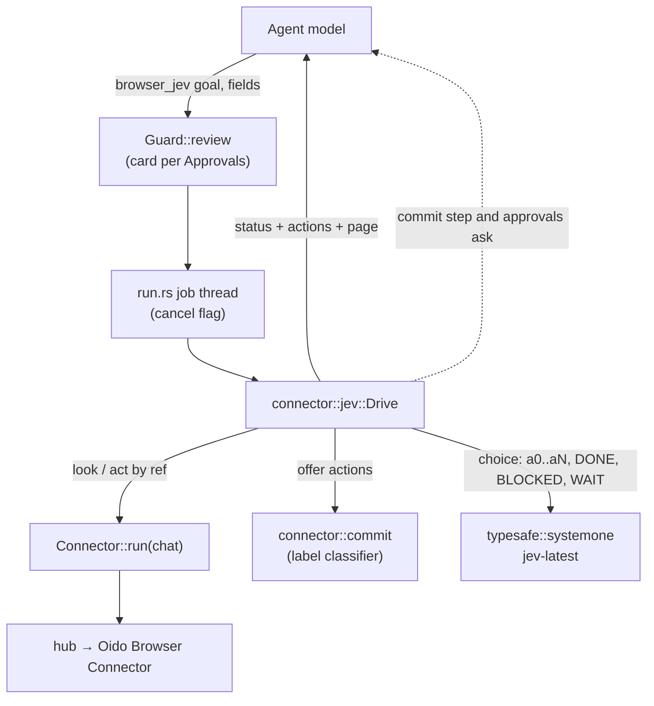

# Browser with Jev

When TypeSafe is connected, an agent that has the `browser` tool also gets `browser_jev`. It hands a
whole browsing goal to Jev (TypeSafe's `jev-latest`), which picks one action at a time from what the
page offers and runs it through the same Connector until the goal shows, it gets stuck, or its step
budget runs out. A ten-click flow then costs one tool call and one model turn instead of ten.

It is a port of oido-core's `browser_jev` (`internal/noninteractive/browser_jev.go`,
`internal/browseragent/jev.go`, the commit classifier in `internal/browseragent/gate.go`), changed
to fit Desktop's approvals, its Stop button and its Connector.

Status: P1 built 2026-11-18 on `feat/browser-jev` (`src/connector/jev.rs`, `src/connector/commit.rs`).
Unit tests run on a fake browser and scripted TypeSafe answers. The live test drives the real
Connector in headless Chromium and asks TypeSafe for real:
`OIDO_CONNECTOR_DIR=…/oido-browser-connector TYPESAFE_API_KEY=… cargo test jev_searches -- --ignored`.

## Requirements

Functional:

- Chosen per agent in the Tools picker (Browser group), offered only while TypeSafe is
  connected. Without TypeSafe it is not offered. A call that arrives anyway is refused with the Providers-page hint, as the TypeSafe tools
  are.
- Arguments as in core: `goal` (required), `fields` (name → exact text), `url`, `max_steps`
  (default 15, at most 30), `approved_step`. `files` waits for upload in the browser tool (P2).
- Jev only places values the caller gave it, never types into a password box, stays on the site it
  started on, and offers no action whose label repeats on the page.
- Every action runs through `Connector::run` for the chat, so the chat's refs, the lost-result
  guard, the per-tab site lock and the extension's allowlist all apply, and the model's next
  `browser` call sees the same refs.
- The result has the same shape as core's: status line, the numbered actions, and the current page
  as rendered, so the model can check the result without another read.

Non-functional:

- Stop ends the drive between steps. Core can't do this (its drive only checks its 3-minute
  deadline).
- One Jev request per step (plus one for field matching on a page with new boxes), each with an
  8-second timeout (core uses 4 s, but it asks from a server, not a home connection). The whole
  drive is capped at 3 minutes.
- No new dependencies. TypeSafe's request code is shared with `src/typesafe.rs`.
- Tests use a fake browser and fake decisions. One ignored end-to-end test runs the real Connector
  with a real TypeSafe key.

## Shape

Modules:

| Where | What |
|---|---|
| `src/connector/jev.rs` | Tool spec and description, the page's action list (`JevActions`), field matching, the drive loop and its result text. The drive is generic over a small `Browse` trait (look, act) and a decide function, so tests use fakes. |
| `src/connector/commit.rs` | Port of core's `judge`: whether an action commits, and why. Rules: a click whose label matches the consequential-word regex (counter icons excepted, unknown or unlabelled targets held), any `submit`, Enter outside a search box, `drag`, accepting a dialog. |
| `src/connector/mod.rs` | `Connector::look(chat)`, which returns the parsed `render::Page` with its rendered text and remembers its refs. `act` is split into `send` (dispatch, lost-result guard) and `seen` (take in a read), which `look` shares. Jev acts with `read: false` and then looks once itself. The chat's memory also counts look-only Jev calls in a row, for the STOP warning. |
| `src/typesafe.rs` | `pub fn systemone(base, key, &Value, images) -> Result<Value, String>`, taken out of `ask`, so the drive and the four tools share one HTTP path and one set of error words. |
| `src/run.rs` | Runs `browser_jev` as a job on its own thread, like `browser`, with the TypeSafe key, a clone of the Connector, the commit policy and the cancel flag. |
| `src/tools.rs` | `browser_jev` is registered, and `needs_typesafe` covers it. `offered` puts the preference paragraph on `browser` when both are given. Summary line: the goal or the approved step, the url, the values. |
| `src/guard/mod.rs` | `connector::kind` knows `browser_jev` (see ADR-J2). |

## Decisions

**ADR-J1: port core's drive, not its plan cursor.** Core has two TypeSafe drivers. `plan_driver`
follows a written step list, and its step-done checks misfired, so core made it one-shot (core
ADR-020 amendment). The Jev drive asks one closed-set question per step: which of these concrete
actions, or DONE, BLOCKED or WAIT. Nothing can advance on a false "step done". Its tuning came from
live runs and is kept as is, constants included: the floors (0.55 click, 0.35 placing a value, 0.75
scroll, 0.8 commit), 120 options per question, 12 history lines, 8 fields, 15 boxes, 2
stale re-reads. Rejected: letting the model drive Jev step by step (that is the `browser` tool),
and a local model (no calibrated choice model is installed, and TypeSafe is what the person
connected).

**ADR-J2: approvals: one card per call, a second for each step that commits.** Desktop's one
browser setting decides both, through the existing `Approvals::check(Kind::Act, outside)`:

| Setting for clicking and typing | A `browser_jev` call | A step that commits |
|---|---|---|
| Never ask | runs | Jev takes it |
| Ask after reading a page (default) | card while a page is in view (the usual taint rule) | stops the drive: `awaiting_approval` |
| Always ask | card | stops the drive: `awaiting_approval` |

The call's card (its summary line: `goal — on url — typing name: "value"`) shows the goal, the fields and the url, so the person approves the task and its
exact values once, not each click. Clicks that can be undone then run without asking. That is the
point of Jev, and the commit classifier still catches the irreversible ones. At a step that
commits, the drive ends with the exact call to make: the same `goal` and `fields` plus
`approved_step` (the action's words, such as `Click "Post"`). A call that carries `approved_step`
always gets a card, whatever the taint state, unless the setting is Never ask. That card is the
grant. The approved step is matched by its words on a fresh read (refs can shift). If it is gone,
the call ends `approval_stale` and nothing runs. Core needs a grant store and a suspend, because
its approvals happen out of band. Desktop's card already sits before the call runs. Rejected: no
card for the call (core parity), because it would let clicks run unreviewed against the person's
"ask" setting. Also rejected: handing commits back to `browser`, which costs the model an extra
call, and the person would then approve a bare `click c14`.

**ADR-J3: commits are judged by a label classifier, ported as is.** Core's `consequentialLabel`
regex, the counter-icon exception, the search-box Enter rule, and "held when unsure". It fails
closed: a click on a target the last read didn't show, or one with no label, counts as committing.
It is deterministic on purpose (core ADR-012, ADR-019: an advisory prompt was ignored, and
TypeSafe's own needs-approval answer is not calibrated yet). It decides only for Jev for now. The
`browser` tool keeps its per-kind approvals (ADR-5 in browser.md). Narrowing those to commits is a
separate decision (Next).

**ADR-J4: chosen per agent, like a TypeSafe tool.** "Browse with Jev" is listed in the agent
form's Tools picker under Browser while TypeSafe is connected, and an agent has it only when
chosen. It works without "Use your browser" too: Jev alone, with the leftover steps going to the
person. With both chosen, `browser`'s description starts with core's preference paragraph
("browser_jev IS AVAILABLE: hand it whole tasks…"), which core added after a model put thirty
actions on `browser` when it had both and no preference. `needs_typesafe` covers it, so it is not
offered or run without TypeSafe. Its waits stay the browser setting's, not the taint rule's
(`taint::acts` names TypeSafe's own tools only). Team members and workflow steps don't get it, as
they don't get `browser`. First built as automatic beside `browser`: dropped because nothing showed
it anywhere, so the person could not see that it was there.

**ADR-J5: the guidance lives in the tool description.** Desktop skills come from the person's
`~/.agents/skills`, so there is no bundled `browser-jev` skill to load. The description holds core
SKILL.md's essentials: goal as an end state, every value to type in `fields`, name the answers to
pick, say when the task ends in a post or send, the status table, and verify `needs_verification`
against the page.

**ADR-J6: refs and memory are the chat's.** The drive reads and acts through `Connector::run` with
the chat id, so the refs Jev acted on are the ones the model sees next, and the lost-result guard
covers Jev's clicks too. Each action takes the Connector's turn lock, so other chats can act
between Jev's steps. Their refs are their own (browser.md ADR-6).

## Statuses

`needs_verification`, `awaiting_approval`, `approval_stale`, `blocked`, `low_confidence`,
`no_progress`, `step_limit`, `budget` (3 minutes), `left_site`, `loading_timeout`, `decision_error`,
`action_error`, as in core, plus `stopped` (the person pressed Stop: what ran is listed, and the
page as last read). Not used: `held` and `not_approved` (ADR-J2 and ADR-J4 leave no path to them).

## Failure modes

- TypeSafe errors (key refused, HTTP error, unknown choice, confidence outside 0 to 1):
  `decision_error`, with the Providers-page hint for a refused key. Nothing is guessed.
- A field-matching request fails: its check is skipped and the step goes on unfiltered, as in core.
- Connector not connected, or dropped mid-action: `action_error` with the Connector's own words
  (install link, or "may have been applied, read first"). The lost-result guard then refuses a
  blind repeat.
- Stale target (the Connector says "resolves to different content") or a control covered by
  something ("is covered by"): read again and let Jev pick again, at most twice per call. The
  failure goes into Jev's history ("covered by <input> (Where else?), a popup is open"), so it can
  choose from the popup or press Escape. If it still stops, the result says that what is on top is
  most likely the page's own popup, not something the person must close. Live on 2026-11-18, the
  model asked the person to close a "cookie banner" that was in fact Google Flights' airport
  picker.
- Suggestions that come late: the Connector's `type` waits (up to 1 s) until a combobox's list
  has options before it answers (`awaitSuggestions` in oido-browser-connector), so the next read
  shows them. Live, the read right after typing "Larnaca" came before the airport list. A first fix
  waited 0.8 s in Desktop; it moved into the Connector, where core and the `browser` tool get it too.
- Calendar days: the Connector gives a day cell its date as `near` (`oidoDayContext`: `data-iso`,
  else the grid's name, else the month heading), so Jev reads `"22 €456" near "2026-12-22"`, not a
  bare "22 €456" that is the same in December and January. Live, Jev picked the right day at
  0.50–0.53, just under the click floor, on every call.
- Lost progress: a model resent `url` with every retry, reloading Google Flights and losing the
  destination an earlier call had set. The description says `url` is for the first call only, and
  every stop result that can be continued says to call again without it. The description also asks
  for values as a person types them into a search box ("LCA", not "Larnaca International Airport
  (LCA)", which matched nothing), and to start from a search address that carries the query when
  the site has one (Google Flights' `?q=Flights from X to Y on DATE through DATE`), which skips the
  form.
- A page still loading: Jev's WAIT pauses 1.5 s, up to 6 times (about 9 s) before
  `loading_timeout`. Core's 3 × 0.75 s gave up on Google Flights while its results loaded, after
  the search had run.
- Unsure: a `low_confidence` result names the ref of Jev's best guess, and says to take it with
  `browser` when the agent has it, and otherwise not to resend the same call on an unchanged page.
  Live, a model with only `browser_jev` resent it five times.
- No effect twice in a row ("nothing changed on the page"): `no_progress`.
- The browser leaves the starting host (compared without `www.`): `left_site`.
- Stop: the drive checks the cancel flag before each step and after each request, and ends
  `stopped`. An action already sent to the browser finishes.

## Security

- Page text is untrusted. Jev answers a closed set of options, so a page can't add an action. It
  can only bias a choice among the page's own actions, and commits stay behind the classifier and
  the card.
- Typed text comes only from `fields`, which the person saw on the call's card. Password boxes are
  never offered.
- The guardrails still apply to the call itself: secret placeholders in `fields` are revealed only
  on-machine. `browser_jev` counts as off-machine (it goes to TypeSafe and to websites), so a
  hidden secret in `fields` asks first.
- Logs leave out URL queries (`stripURLQuery`).

## Phases

- **P1**: everything above. `commit.rs` with core's gate tests ported, `jev.rs` with core's
  `jev_test.go` and `browser_jev_test.go` cases on fakes, `typesafe::systemone`, the run and guard
  wiring, offering, the preference paragraph, and docs.
- **P2**: `files` once the browser tool can upload. The click-streak nudge in `browser` results
  (core's `nudgeJev`, after 3 clicks in a row). The last URL on the commit card.
- **P3 (separate decision)**: use `commit.rs` to narrow the `browser` tool's "Clicking and typing"
  approvals to commits only.

## Risks

| Risk | Mitigation |
|---|---|
| The classifier misses a commit whose label is unusual ("Go", "Done" on a payment form) | Fails closed on `submit` and on Enter in a form, and the call's card already showed the goal and values. P3 can add TypeSafe's answer as a second opinion once it is calibrated. |
| Floors tuned on core's traffic misfire on Desktop pages | Same Connector and same read, so same pages. Log each pick, its confidence and the option count (as core does), and retune from those. |
| The model sets `approved_step` itself | Its card always shows (ADR-J2), so the person sees the exact step before anything runs. |
| A drive holds the turn lock for long | It doesn't: the lock is taken per action, never for the whole drive. |
| TypeSafe cost per step | Same as core: one request per step, field answers memoised per call. |
