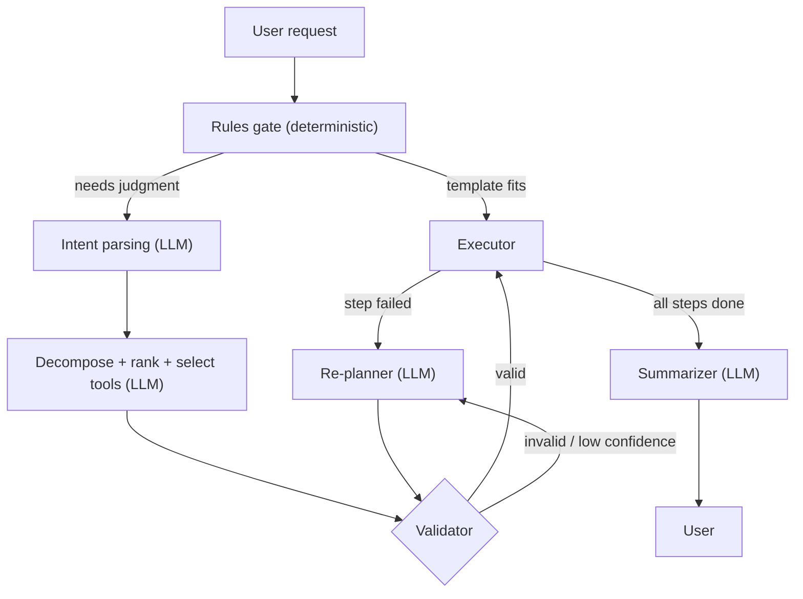
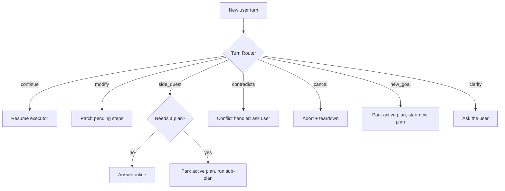

# LLM Kick-In Planning Flow — Architecture & Implementation Guide

**Purpose:** A design + build reference for a planning agent that uses deterministic rules first and kicks in an LLM only when "smart" conditions require it. Covers mid-conversation pivots, side-quests, and dead-end prevention.

**Stack note:** Uses TypeSafeAI (typed, schema-validated LLM calls) at every "smart if condition" — the LLM is invoked only where semantic judgment is needed, and its output is always validated against a type before it can mutate state.

## Table of Contents

1. [Core Idea](#1-core-idea)
2. [The Base Flow](#2-the-base-flow)
3. [Turn Router — Handling Mid-Conversation Pivots](#3-turn-router--handling-mid-conversation-pivots)
4. [Dead-End Catalog](#4-dead-end-catalog)
5. [Data Model](#5-data-model)
6. [Where TypeSafeAI Kicks In (Smart If-Conditions)](#6-where-typesafeai-kicks-in-smart-if-conditions)
7. [Roles: Idea → LLM → Architect → Implementation](#7-roles-idea--llm--architect--implementation)
8. [Guardrails Checklist](#8-guardrails-checklist)
9. [Worked Example: One Conversation, Many Turns](#9-worked-example-one-conversation-many-turns)
10. [Implementation Phases](#10-implementation-phases)
11. [Mapping to Oido](#11-mapping-to-oido)

---

## 1. Core Idea

Given a user request:

1. Decide whether a deterministic plan suffices.
2. If not, use an LLM to decompose, rank, and select tools.
3. Execute with recovery.
4. Summarize the result.

But conversations don't stop at one request. A user can pivot, add side-quests, contradict, or drift. The system must treat the **session** as the unit of state, not the single request — and classify every new turn before it touches the active plan.

## 2. The Base Flow



### Kick-in points

| Stage | LLM trigger | Why LLM (vs. rules) |
|---|---|---|
| Intent parsing | Ambiguous / free-text request | NL understanding |
| Decomposition | Multi-step goal, not templated | Open-ended reasoning |
| Ranking | Multiple valid orderings | Judgment / heuristics |
| Tool selection | Dynamic toolset, context-dependent | Semantic matching |
| Re-planning | Low confidence or failed step | Recovery reasoning |
| Summarization | Final user-facing output | NL generation |

## 3. Turn Router — Handling Mid-Conversation Pivots

Every new user turn passes through a **Turn Router** before touching the plan. This is the single most important node for dead-end prevention.



**Rule:** every arrow out of TR must be a named handler. If a turn can't be classified, it routes to `clarify` — never a silent fall-through.

## 4. Dead-End Catalog

Exhaustive list of ways a mid-conversation message breaks naive planning, and the handler for each.

| # | Dead end | Example | Handler |
|---|---|---|---|
| 1 | **Plan drift** — new ask invalidates an unexecuted step | "Book a flight to Paris" → "actually Rome" | Patch plan: diff old vs new, invalidate stale steps |
| 2 | **Contradiction** — new ask conflicts with a committed step | "Book non-refundable" → "wait, refundable" | Detect conflict → ask user before proceeding |
| 3 | **Side-quest** — unrelated small ask mid-plan | "...and what's the weather?" | Trivial → answer inline; non-trivial → park active plan, run sub-plan |
| 4 | **Abort** — user changes mind | "forget it, cancel" | Teardown + confirm what was already executed |
| 5 | **Ambiguous reference** — "do that thing" | Refers to parked/old plan | Resolve against transcript + plan stack; else clarify |
| 6 | **Partially executed plan** — step 1 done (side effect), user changes step 2 | Booked hotel, wants different flight | Patch only unexecuted steps; surface side effects |
| 7 | **Re-plan loop exhaustion** — replanner keeps failing | Tool keeps erroring | Cap attempts → summarize failure, ask user |
| 8 | **Confidence collapse** — new info tanks confidence | New constraint invalidates plan | Route back to rules gate / re-enter planner |
| 9 | **Stack overflow** — nested side-quests | Side-quest within side-quest | Cap plan-stack depth → force-resolve or ask |
| 10 | **Orphaned parked plan** — session ends with suspended plans | User leaves | Persist parked plans; TTL + resume-on-return or confirm-discard |
| 11 | **Stale tool state** — external world changed while parked | Price changed while plan parked | Re-validate on resume, not just on create |
| 12 | **Contradicts a completed step** | "undo the hotel" | Route to compensation/undo handler, not re-plan |

## 5. Data Model

Separate the **plan** from the **session**; make plans patchable and parkable. State is stored per working folder under `.oido/` (see [Mapping to Oido](#11-mapping-to-oido)), so the shape below is split across `session.json` and `plans/<id>.json`.

```jsonc
// Session state — lives for the whole conversation
{
  "session_id": "uuid",
  "transcript": [ /* full message history */ ],
  "active_plan_id": "p1",          // or null
  "plan_stack": ["p1"],            // parked plans (LIFO for side-quests)
  "plans": {
    "p1": {
      "status": "active",          // active | parked | done | aborted
      "steps": [
        { "id": 1, "action": "book_flight", "status": "done",    "side_effect": true  },
        { "id": 2, "action": "book_hotel",  "status": "pending", "side_effect": false }
      ],
      "created_from_turn": 3,
      "parked_at_turn": null
    }
  }
}
```

Load-bearing properties:

- **Per-step `status`** — patch only `pending` steps; never re-run `done` ones (dead end #6).
- **`side_effect: true`** — flags irreversible steps. Any change touching these routes to CONFLICT → ask user (dead ends #2, #12).

## 6. Where TypeSafeAI Kicks In (Smart If-Conditions)

TypeSafeAI is used at every node where a decision requires semantic judgment — the "smart if conditions." The LLM classifies or drafts; typed validation gates whether its output can mutate state.

### 6.1 The principle

```text
LLM proposes  →  TypeSafeAI validates against schema  →  deterministic code applies transition
```

The LLM never gets to unilaterally change session state. It returns a typed object; the state machine accepts or rejects it.

### 6.2 Node-by-node: LLM vs. deterministic

| Node | LLM? | TypeSafeAI role | Why |
|---|---|---|---|
| Turn Router classification | Yes | Validated enum `TurnType` | Can't tell "modify" from "side-quest" with rules |
| Conflict detection | Yes | Validated `ConflictReport` | Must reason over committed steps + side effects |
| Plan patching (diff) | Yes | Validated `PlanPatch` | Structured rewrite against schema |
| Side-quest triviality check | Yes | Validated `SideQuestVerdict` | "Is this a quick answer or a real sub-goal?" |
| Abort / teardown | No — deterministic | — | Pure state transitions + confirmation |
| Resume re-validation | No — tool calls | — | Check external state, not reasoning |
| Loop / depth caps | No — config | — | Hard limits in code |
| Confidence gate | No — numeric | — | Threshold comparison |

### 6.3 Typed schemas for the smart conditions

```ts
// Turn Router output — the most important type in the system
type TurnType =
  | "continue"        // proceed with active plan
  | "modify"          // patch active plan
  | "side_quest"      // unrelated sub-goal
  | "cancel"          // abort
  | "contradicts"     // conflicts with committed step
  | "new_goal"        // unrelated new plan
  | "clarify";        // cannot classify — safe default

interface TurnClassification {
  type: TurnType;
  confidence: number;          // 0..1
  referenced_plan_id?: string; // for resume / ambiguous refs
  rationale: string;           // logged for debugging
}

// Side-quest triviality — decides inline answer vs. sub-plan
interface SideQuestVerdict {
  needs_plan: boolean;
  estimated_steps: number;
  reason: string;
}

// Conflict report — gates mutations touching side effects
interface ConflictReport {
  has_conflict: boolean;
  conflicting_step_ids: number[];
  touches_side_effect: boolean;
  suggested_resolution: "ask_user" | "patch_pending_only" | "abort";
}

// Plan patch — the only way an LLM mutates a plan
interface PlanPatch {
  plan_id: string;
  operations: Array<
    | { op: "update_args"; step_id: number; args: Record<string, unknown> }
    | { op: "drop_step"; step_id: number }
    | { op: "insert_step"; after_step_id: number; step: PlanStep }
  >;
  // Engine rejects any op targeting a step with status !== "pending"
}
```

### 6.4 Example: Turn Router as a TypeSafeAI call

```ts
const classification = await typeSafeAI.generate({
  schema: TurnClassificationSchema,
  system: TURN_ROUTER_PROMPT,
  input: {
    userTurn: message,
    activePlan: session.activePlanId ? summarizePlan(session) : null,
    committedSteps: getDoneSteps(session),   // includes side_effect flags
    planStackDepth: session.plan_stack.length,
  },
});

// Deterministic gate — the LLM cannot bypass this
switch (classification.type) {
  case "continue":    return executor.resume(session);
  case "modify":      return patchPlan(session, classification);
  case "side_quest":  return handleSideQuest(session, classification);
  case "cancel":      return abortPlan(session);          // deterministic
  case "contradicts": return conflictHandler(session, classification);
  case "new_goal":    return parkAndStart(session);
  case "clarify":     return askUser(session, classification.rationale);
}
```

### 6.5 Guardrails on TypeSafeAI calls

- **Validate before mutate** — a schema-valid response is the only ticket to a state transition.
- **Cap clarifications** — if `TurnClassification.type === "clarify"` N times in a row, escalate (don't loop).
- **Log rationale** — every smart condition stores its reasoning for debugging.
- **Reject side-effect patches in code** — the engine, not the LLM, enforces "never touch `done` steps."
- **Fallback type** — if generation fails validation, default to `clarify`, never guess.

## 7. Roles: Idea → LLM → Architect → Implementation

```text
Idea          → LLM (designer)     → Architect          → Engineer
─────────       ─────────────        ─────────            ─────────
Problem         Kick-in nodes,       Contracts,           Code + tests,
statement       trade-offs,          component map,       eval harness,
+ success       failure modes        ADRs, thresholds     tracing
criteria
     │               │                    │                    │
     └───────────────┴────────────────────┴────────────────────┘
                    every artifact feeds the next
```

### 7.1 Idea

One-paragraph problem statement + success criteria (latency, cost, accuracy).

### 7.2 LLM as design partner

| Task | Prompt pattern | Output |
|---|---|---|
| Enumerate decision points | "List every branch where a rule could fail" | Candidate kick-in nodes |
| Compare architectures | "Single-agent vs. planner-executor" | Trade-off table |
| Draft contracts | "Define the JSON schema for a Plan object" | Interface spec |
| Stress-test | "What failure modes break this plan?" | Risk list |

The LLM proposes; you decide. Treat output as a draft spec.

### 7.3 Architect

Deliverables:

- **Component map** — Router / Planner / Executor / Re-planner / Validator
- **Interface contracts** — the typed schemas in §6.3
- **NFRs** — gate location (deterministic), confidence threshold (config), loop/depth caps, state store, tracing
- **ADRs** — Architecture Decision Records

### 7.4 Implementation order

1. Skeleton with stubs — gate + planner interface + executor, using a mock planner.
2. Wire TypeSafeAI nodes — structured output for every smart condition.
3. Executor + feedback loops — validator, replanner, loop caps.
4. Summarizer + observability — trace every LLM call (input, output, latency, tokens).
5. Eval harness — golden set; measure % rules-handled, % re-plan, latency, token cost.

## 8. Guardrails Checklist

- [ ] Classify every turn before touching the plan — TR is mandatory, never bypassed.
- [ ] Never mutate `done` steps — only patch `pending`; side effects route to user.
- [ ] Cap every loop — re-plan attempts, plan-stack depth, clarification retries.
- [ ] Park, don't discard — side-quests suspend the parent plan; resume re-validates.
- [ ] Re-validate on resume — external state may have changed.
- [ ] Every unclassifiable turn → `clarify` — the safe default, never silent fall-through.
- [ ] Persist the session — parked plans + transcript survive disconnects (TTL + resume).
- [ ] Surface side effects explicitly — irreversible steps confirmed before execution.
- [ ] TypeSafeAI output is the only ticket to a state transition — validate before mutate.
- [ ] Log rationale on every smart condition for debugging.

## 9. Worked Example: One Conversation, Many Turns

| Turn | User says | Router classifies | What happens |
|---|---|---|---|
| 1 | "Plan a trip to Paris" | `new_goal` | Plan p1 created, approved |
| 2 | *(executor running)* | — | Step 1 `book_flight` = done (side effect) |
| 3 | "what's the weather in Paris?" | `side_quest` (trivial) | Answer inline; p1 untouched |
| 4 | "make the hotel 5-star" | `modify` | Patch p1: hotel args updated (pending, safe) |
| 5 | "wait, cancel the flight" | `contradicts` (done, side effect) | ConflictReport → ask user: "Flight booked (refundable?). Undo?" |
| 6 | "book me a car in Rome" | `new_goal` | Park p1, create p2 |
| 7 | "ok done, back to Paris trip" | `continue` (resolve p1) | Pop p1, re-validate stale steps, continue |

Every turn is classified; no turn silently mutates the plan.

## 10. Implementation Phases

| Phase | Goal | Exit criterion |
|---|---|---|
| 1 — Skeleton | Gate + planner interface + executor with mock planner | Executor testable without LLM |
| 2 — TypeSafeAI nodes | All smart conditions return validated types | Schema-invalid outputs rejected, fall back to `clarify` |
| 3 — Feedback loops | Validator + replanner + loop caps | Re-plan cap enforced; failures surfaced |
| 4 — Observability | Trace every LLM call | Inputs/outputs/latency/tokens logged per node |
| 5 — Eval harness | Golden-set evaluation | Baseline metrics: % rules-handled, % re-plan, latency, cost |

### Appendix: Design Principles

1. **Rules first, LLM when smart** — the gate is a cost firewall.
2. **The LLM proposes, the state machine disposes** — typed validation is the contract.
3. **Every turn is classified** — no silent fall-through, ever.
4. **Patch, don't rewrite** — only `pending` steps; side effects route to the user.
5. **Park, don't discard** — suspend and resume, re-validating on return.
6. **Bound everything** — loops, depth, clarifications.
7. **Ship the eval harness with v1** — you can't tune thresholds without data.

---

## 11. Mapping to Oido

Oido already has a script engine and a concurrent task runner. This design builds on them rather than beside them.

### What exists

| Piece | Where | Relevance |
|---|---|---|
| Workflow engine | `src/workflow/` (`docs/workflow-builder.md`) | A saved step list run by a tree walker. Rhai for conditions and `code` steps. Step kinds: `tool`, `generate`, `decide`, `set`, `code`, `if`/`switch`, `for_each`/`while`, `try`, `wait`, `parallel`, `flow`, `delegate`. Per-step trace, Stop, loop and script caps, guard gate. |
| Concurrent tasks | `src/delegate.rs` | Several `delegate` calls in one turn run side by side. Each is its own run, linked to the parent run. Workers are unattended. |
| Background processes | `src/background.rs` | Long processes kept per chat, ended with the chat. |
| Jev tools | `src/typesafe.rs` | `typesafe_yes_no`, `typesafe_choose`, `typesafe_score`, `typesafe_locate`: one question per call. |

### How the design lands

- **Plan ≙ workflow `Definition`.** The engine has no per-step `done` / `pending` status to patch against, and a run ends when a step fails. Step status and `side_effect` are new fields the engine would need before "patch only pending steps" is enforceable.
- **Concurrency is `parallel` and `delegate`.** Nothing new is needed for side-by-side work. The **plan stack** (park / resume) is new; it can build on the persistence `wait` already has, so a parked plan survives the app closing.
- **Smart conditions** land on the `decide` step and the `typesafe_*` tools. A plan patch is a regular model call whose output is validated against the schema, then applied by code.
- **Jev answers judgments, it does not generate objects.** It returns a Choice, a Noul (probability a statement is true) or a Score. Wherever §6 says TypeSafeAI "generates" a typed object (`ConflictReport`, `PlanPatch`, `TurnClassification`), read it as Jev judgments for the yes/no and choice parts (turn type, touches-a-done-step, needs-a-plan) plus a normal model call for the structured text. Code maps the judgments to a handler and writes the thresholds; `confidence` is not the gate.

### Storage: `.oido/` in the working folder (decided)

Plan state lives in the chat's working folder, not in `oido.db`. Nothing in the repo writes a `.oido` folder yet, so this is new.

```text
<working folder>/
└── .oido/
    ├── session.json        # active_plan_id, plan_stack, schema version
    ├── plans/
    │   ├── p1.json         # steps, status, side_effect, parked_at_turn
    │   └── p2.json
    └── transcript.jsonl    # turns the router saw, append-only
```

Why:

- **Tab and model independent.** Any tab, chat or model pointed at the same folder picks up the same plans. Switching models mid-plan loses nothing, because the plan is not in a model's context.
- **Follows the work.** The side effects a plan records (files written, commands run) are in that folder too, so plan and result travel together.
- **Inspectable.** Plain JSON, readable and diffable by the user.

Rules this adds:

- **One writer at a time.** Two tabs on one folder can both route a turn. Take a lock file (`.oido/lock`) for each transition, write to a temp file and rename, and re-read `session.json` before applying a patch. A patch built on a stale read is rejected, the same way a patch to a non-`pending` step is.
- **Version the files.** `session.json` carries a schema version so a later build can migrate it.
- **Keep secrets out.** Tool arguments in a plan can hold tokens. Store a reference to the vault entry, never the value.
- **Guard rules apply.** `.oido/` is inside the working folder, so the guard's folder rules already cover who may write it. A plan file edited by the model with `edit_file` would bypass validate-before-mutate, so list `.oido/` as a blocked place for model file tools (`docs/guardrails.md`); only the engine writes it.
- **Git.** Suggest adding `.oido/` to `.gitignore`; do not edit it for the user.
- **Orphans.** Parked plans in a folder that is never opened again are harmless files. TTL (dead end #10) is checked on open, not by a background sweep.

### Open questions

- Whether the router runs before every chat turn, or only while a workflow run is active.
- Whether `side_effect` is declared per tool, per step, or inferred from the tool's guard class.
