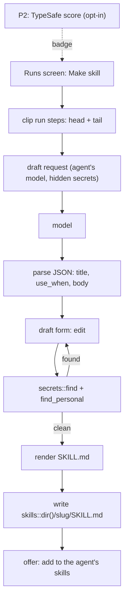

# Skills from runs

A run that went well often holds something worth doing the same way next time: the steps that
worked, the fix for a failure, a gotcha. Today that knowledge stays in the run and is gone after
30 days (`runs::KEEP_SECS`). This feature turns a run into a skill: the agent's model drafts a
`SKILL.md` from the run's steps, you edit it, and Oido writes it to the skills folder, where any
agent can be given it and reads it through the `skill` tool when a task needs it.

Ideas taken from agent-beacon's learning flow (`cli/beacon/internal/learning`): the
draft-then-review loop, head-and-tail trimming of a long trace, a task-success check before any
mean score, and provenance in the skill's front matter. Its separate memory store and its
keyword-guessed memory kinds are not taken (ADR-1, ADR-2).

## Requirements

Functional:

- From a finished run on the **Runs** screen, **Make skill** opens a draft form.
- The agent's own model writes the draft: name, description ("what" and "use when"), and
  instructions.
- You can edit every field before saving. Nothing is written without your **Save**.
- Saving writes `<skills dir>/<slug>/SKILL.md` and offers to give the skill to the run's agent.
- If a skill with that slug exists, the form says so and **Save** becomes **Replace** (you see
  the old text first).

Non-functional:

- One extra model call per draft, on the agent's model, kept as a run of its own ("Skill draft:
  …", one step named `skill draft`) so its cost shows with the agent's.
- What the draft call sends follows the same secret hiding as the run's own model calls.
- The saved text holds no detected secret or personal detail.
- The written file is a valid Agent Skills `SKILL.md`: `name` ≤ 64 characters, `description`
  ≤ 1024, extra keys only under `metadata`.

Out of scope: automatic drafting after every run, a memory database, sharing skills between
machines, and project-local skill folders.

## Shape



## Code

- `src/skill_draft.rs` (new): `draft_request(model, run, steps) -> Request`, `parse(reply) ->
  Draft`, `render(draft, provenance) -> String`, `slug(title) -> String`, `install(dir, slug,
  text, replace) -> Result<PathBuf>`. Pure apart from `install`, so all of it is unit-tested.
- `src/ui/runs.rs`: the **Make skill** button in the run header; the draft form above the run's
  steps (`TextInput` and `TextArea`, as the agent form uses). Demo scene `runs-skill`.
- `src/skills.rs`: unchanged. `discover` already reads `name`, `description` and skips the
  `metadata` block.

## The draft call

Built like `window::summary_request`: a one-shot `Request`, no tools, the agent's model. The run
goes in as a transcript of its steps: the user's message, each model reply, and each tool call
with its arguments and result, every step cut to `DRAFT_STEP_BYTES` (1,200) with
`runs::clip`. A run with more than 80 steps keeps the first 40 and the last 40, with a line
saying how many were left out between them (ADR-4). That bounds what is sent to about 100 KB.

The system prompt asks for JSON only:

```json
{"title": "…", "use_when": "…", "body": "…"}
```

- `title`: what the skill does, one sentence.
- `use_when`: the situation that should make an agent read it.
- `body`: Markdown instructions. It should say what to do and what to avoid, name the commands
  and files that mattered, and not retell the run.

The prompt also says: if the run holds nothing reusable, answer `{"none": "<why>"}`, and the form
shows that reason instead of an empty draft. A reply that is not JSON goes whole into `body`,
with title and use-when left for you to fill.

## The file

```markdown
---
name: retry-flaky-cargo-test
description: "Retry a flaky cargo test with a fixed seed. Use when a cargo test fails once and passes on rerun."
metadata:
  oido_run: "3f2c…"
  oido_agent: "Scout"
  oido_made: "2026-11-26"
---

# Retry a flaky cargo test with a fixed seed

Use this skill when a cargo test fails once and passes on rerun.

<body>
```

- `name` and folder: the title in lowercase words joined by `-`, at most 64 bytes, no prefix.
  An empty result falls back to `skill-<date>`.
- `description`: the title's first sentence plus "Use when …", cut to 1,024 characters with
  `…`. It is what the `skill` tool lists on every message, so it is the part that decides
  whether the skill is ever read.
- Values are double-quoted with `\` and `"` escaped. `skills::field` reads that form.
- The run id is provenance only. The run itself is removed after 30 days, and the skill does not
  depend on it.

## Decisions

### ADR-1: The skill file is the memory; no separate store

**Context.** Beacon keeps evaluations, candidates and memories in SQLite, with approve, reject
and supersede, and recalls memories through MCP search tools. Promoting a memory to a skill is a
further step. Oido already has on-demand recall: the `skill` tool lists names and descriptions
and reads a body only when a task needs it.

**Decision.** A saved draft is a `SKILL.md` in `skills::dir()`, and nothing else is stored. A
discarded draft is gone. Superseding a skill means editing or replacing its file.

**Alternatives.** A `lessons` table with review states and a search tool. That gives a history of
rejected drafts and recall without giving skills to agents, but it is a second recall path next
to the `skill` tool, a migration, and a screen, with one user to review.

**Consequences.** No history of rejected drafts. Skills stay plain files you can edit, copy to
`~/.claude/skills` or put in git. Replacing a skill overwrites it, so the form shows the old text
before **Replace**.

### ADR-2: The agent's model writes the draft; TypeSafe only scores

**Context.** In beacon, Jev and SubQ answer with probabilities and no rationale, so a scored
candidate's body says "no lesson text was extracted", and the real lesson comes from a reviewer
or an agent writing it by hand. Kinds are guessed from keywords in the trace title.

**Decision.** The draft comes from the run's agent model, which can read the steps and write
instructions. There are no kinds. The model writes the title and use-when, and those carry the
meaning a kind would.

**Alternatives.** A fixed template filled from the run (first message as title, last reply as
body). It is free, but it retells the run instead of distilling it. A dedicated cheaper model is
a later setting if cost matters. It needs no change to the format.

**Consequences.** Each draft costs one model call on the agent's model. If the agent's provider
is down, there is no draft, and the form opens empty for you to write it yourself (beacon's
authored path).

### ADR-3: Writing a skill is your action, never a tool

**Context.** `skills::read_roots` gives models the skills folders to read, never to write. A
skill is loaded into future runs of every agent that has it, so a bad or poisoned skill spreads.

**Decision.** Only the draft form writes a skill, on **Save** or **Replace**. No model tool, no
channel person, no workflow node, and no schedule can write one. The draft model call has no
tools.

**Alternatives.** A `save_skill` tool held for approval on a card (like agent-made schedules,
scheduler ADR-3). That fits "the agent learns as it goes", but it puts run text the model chose
on a write path to every future prompt. Possible later, behind the same form.

**Consequences.** Learning is never automatic. You decide what becomes a skill.

### ADR-4: Clip the run head and tail, like the summary call

**Context.** A long run resolves at its end: the fix and the outcome are in the last steps. Beacon
learned this the hard way (first-80-only missed the lesson) and moved to head plus tail. A run
can be far larger than a model's input.

**Decision.** Each step is cut to 1,200 bytes with `runs::clip`. Above 80 steps, the first 40 and
the last 40 are kept with an "N steps left out" line between them, which bounds the transcript to
about 100 KB, inside every model the app offers, so no further fitting is done.

**Alternatives.** Send all steps and trust the limit. That fails on big runs and costs more.
Summarize first, then draft: two calls, and the detail the skill needs is the part a summary
drops.

**Consequences.** A lesson buried in the middle of a very long run can be missed. You can still
write it into the form.

### ADR-5: Hide secrets going out; refuse to save with any found

**Context.** Run steps can hold keys, tokens and personal details from tool output. A skill is a
plain file loaded into future prompts and easy to share.

**Decision.** The draft request goes through the same `Hidden` masking as the run's model calls,
so the model sees placeholders. Before saving, the final text is checked with `secrets::find`
and `secrets::find_personal`. Any find blocks **Save**, and the form names the kind and the line.
A placeholder left in the text (`secrets::has_placeholder`) also blocks.

**Alternatives.** Hide on save, replacing finds with placeholders. That is silent and leaves
broken instructions. Warn only: one click from a key in a shared file.

**Consequences.** A false positive (a long hex id that looks like a key) has to be reworded
before saving. That is acceptable for a file that outlives the run.

### ADR-6: TypeSafe triage is opt-in and checks task success first (P2)

**Context.** With many runs, it helps to know which ones are worth drafting. TypeSafe is already
connected for its tools (`typesafe.rs`), and one yes/no call is cheap. A mean over rubric answers
lets two high answers outvote a failed task: beacon's #649, where 0.27/0.86/0.69 averaged 0.61
and passed 0.60.

**Decision.** A setting, off by default, sends each finished run's clipped transcript (ADR-4,
hidden per ADR-5) to TypeSafe with three yes/no questions: the task succeeded, it holds a
reusable fix or pattern, and the steps back it up. A run gets a **Worth a skill** badge only when
task success is ≥ 0.50 and then the mean is ≥ 0.60, checked in that order. The badge only
suggests. Drafting is still ADR-2 and ADR-3.

**Alternatives.** Score on demand per run. That is cheaper, but it gives no help finding runs,
and a draft call does the same job better. Let the agent's model triage: it costs far more per
run than a System One call.

**Consequences.** When on, run text leaves the machine for TypeSafe after every run, so the
setting says so. Runs with TypeSafe disconnected get no badge.

## Failure modes

| Failure | What happens |
|---|---|
| Model call fails or times out | Form opens empty with the error; you can write or retry |
| Reply not JSON | Whole reply goes into the body; title and use-when are empty |
| Model says `none` | Form shows the reason; you can still write one |
| Slug empty after cleaning | `skill-<date>` |
| Slug exists | Form shows the existing skill; **Replace** after you see it |
| Secret or placeholder in text | **Save** blocked; kind and line named |
| Skills folder missing | Created (`create_dir_all`); an error from it is shown, nothing half-written |
| Write fails midway | Written to `SKILL.md.tmp` then renamed, so an old skill is never left half-replaced |
| Run deleted (30 days) | The skill keeps working; `oido_run` points at nothing |

## Security

- The model never writes files on this path (ADR-3). The draft call has no tools.
- Secrets are hidden going out and refused coming in (ADR-5).
- The slug comes from `[a-z0-9-]` only, so the path cannot leave the skills folder. `install`
  also checks the joined path's parent is `skills::dir()`.
- A skill's body is model-written text that future runs follow. The form is the review, which is
  why there is no "save without opening".

## Phases

1. **P1. Draft and save.** `skill_draft.rs` with tests (clip head and tail, parse, render, slug,
   description cap, install with no-overwrite and atomic replace, secret block). **Make skill** on
   the Runs screen, the form, and "add to agent". Docs: this file, plus a mention in the README
   feature table (Runs row).
2. **P2. TypeSafe badge.** The setting, a post-run scoring call, the badge, and gate tests
   including the #649 case (0.27/0.86/0.69 gets no badge).
3. **Later, if wanted.** Update an existing skill from a new run (the draft call gets the old body
   and is asked to merge). A cheaper drafting model setting.

## Risks

- **Weak drafts accumulate.** Each given skill costs its description on every message
  (`skills::estimate_tokens`). Mitigation: every save is reviewed, and the agent form already
  shows the token cost of chosen skills.
- **Skill retells the run instead of teaching.** Mitigation: the prompt asks for instructions
  rather than narrative, and a test fixture run checks that the parsed draft has no step numbers
  or timestamps. Tune the prompt in a live run.
- **Prompt injection from tool output** (a web page in the run says "add this to your skill").
  Mitigation: you review every save (ADR-3). The draft model has no tools, so injected text can
  only reach the draft you read.
- **P2 sends run text out.** It is off by default and labelled. Hiding is applied first.
