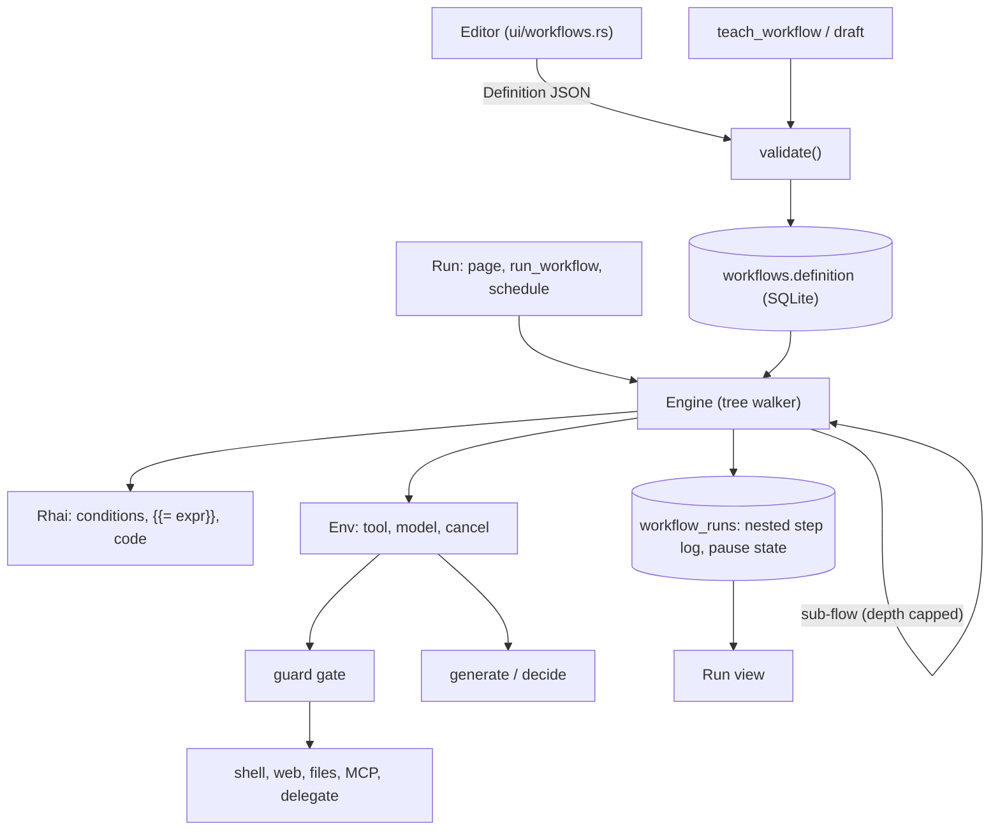

# Workflow builder

Agents run saved flows with branches, loops and fixed steps, so a model does not work out the same
job from scratch each time. You build and edit a flow by hand on the Workflows screen.

Status: agreed 2026-11-13. **Phase 1 built** (branches, loops, `set`, expressions, the editor); **P2 started** (`try`, MCP tools and taint tracking built); P3 not. Extends `src/workflow/` (see `workflow/mod.rs`); read that
first.

## What exists today

A workflow is a list of steps, learned from a chat (`teach_workflow`), saved with its agent, run from
the Workflows page or by an agent's `run_workflow`. Three step kinds: `tool`, `generate` (model
writes text), `decide` (model picks one of fixed options). Five tools: `shell`, web, `read_file`,
`write_file`, `edit_file`. A step that fails ends the run. References are `{{inputs.x}}` and
`{{bound.path}}`. Nothing branches or repeats, and there is no editor.

## Requirements

Functional

- Branch (`if`, `switch`), repeat (`for_each`, `while`), run branches at once (`parallel`), recover
  (`try` with retry and a catch path).
- Helper steps: `set` (build or reshape values), `code` (a script), `http`, `wait` (delay or
  approval).
- Tool steps may call the five current tools, any MCP tool the agent has, another saved workflow of
  the same agent (`flow` step), or hand a task to an agent (`delegate`).
- A visual editor: a stack of cards, one form per step, indented child lists inside containers,
  add / move / delete, a picker for earlier outputs, live validation.
- Started by you or by an agent's `run_workflow`. Schedules already target workflows
  (`docs/scheduler.md`) and need nothing new.
- Old workflows, and drafts learned from a chat, keep working and open in the editor.

Non-functional

- **Deterministic.** A model runs only in `generate`, `decide` and `delegate` steps, and the editor
  marks them. Everything else is the same on every run.
- **Safe unattended.** The same guard gate as agents (`docs/guardrails.md`). A bad definition is
  caught at save time; a run can fail only on data.
- **Bounded.** Every loop, script and run has a cap, so a flow cannot spin forever or eat memory.
- **Stoppable.** Stop works at once, inside loops, scripts, parallel branches and waits.
- **Observable.** A run shows each step as it ran, nested the way the flow is, with iteration
  numbers.
- **Survives the app closing** where it waits for you (approval), and says so where it cannot
  (everything else keeps today's "the app was closed" failure).

Out of scope: schedule or channel triggers inside a flow, a free node canvas, flows shared between
agents, flow versions and history.

## Architecture

The engine stays a pure function of a `Definition` and an `Env`, as now, so it is tested without a
network or shell. Control flow lives in the engine; effects live behind `Env`.

### Definition

Same JSON, `Step` stays one struct with a `kind` string and optional fields (stored definitions
parse unchanged). New kinds and fields, all optional:

| kind | fields | meaning |
|---|---|---|
| `if` | `cond`, `then`, `else` | run one child list |
| `switch` | `on`, `cases: [{when, steps}]`, `default` | first matching case; `default` if none |
| `for_each` | `over`, `as`, `steps`, `on_error` | binds a list of per-item results |
| `while` | `cond`, `steps`, `max` | repeats while true, at most `max` times |
| `parallel` | `branches: [{name, steps}]`, `on_error` | binds a map name → result |
| `try` | `steps`, `retries`, `backoff_ms`, `catch` | catch sees `error` |
| `set` | `values` | map of name → expression, bound as one object |
| `code` | `script`, `input` | Rhai script, returns a value |
| `http` | `method`, `url`, `headers`, `body` | returns status, headers, body |
| `wait` | `seconds` or `approve: "text"` | delay, or pause until you answer |
| `flow` | `workflow`, `inputs` | run a saved workflow of the same agent |
| `delegate` | `agent`, `task` | an agent does the task; its reply is the result |

`tool` steps gain MCP tools by name (`mcp__server__tool`). `bind` works on every kind. A container
sees everything bound before it plus, inside its body, `item`/`index` (for_each) or `error` (catch).
A name bound inside a body is visible only there; the container's own `bind` is what escapes.

### Expressions

One engine, Rhai, in three places:

- Condition fields (`cond`, `on`, `over`, `when`, `set` values) are Rhai expressions over the scope.
- Text fields keep `{{path}}` (path lookup, as now). `{{= expr }}` evaluates Rhai and inserts the
  result. No ambiguity with paths.
- `code` runs a script and returns a value.

Scope = `inputs`, each bound result by name, `item`/`index`/`error` where they exist, as Rhai
values converted from JSON. Rhai has no file, network or process access by default, and none is
added. Caps: operations, call depth, expression depth, string, array and map size, and a wall-clock
check through the progress callback, which also reads the stop flag. Expressions and scripts are
compiled at save time, so a syntax error is shown in the editor, not at run time.

### Run record

`StepLog` gains `path` (index trail, e.g. `2.then.0`) and `iteration`, both defaulted so old
records read unchanged. The log is flat and ordered; the run view indents by `path`. For long
loops, only the first and last iterations keep their full output, the rest keep status and a clipped
line (the 4000-character `KEEP` stays per step).

### Pausing (phase 3)

`wait` with approval saves the run's scope and cursor (`path`) and sets status `waiting`. The run
leaves its thread. It resumes when you answer on the Workflows screen, or after a restart, from the
saved cursor. Needs a migration: `workflow_runs.status` gains `waiting` (SQLite rebuilds the table to
change a CHECK), plus `state` and `waiting_for` columns. A timed `wait` under a few minutes just
sleeps on the run thread and fails on restart like any run; longer ones use the same save.

### Limits (defaults, all in one place)

| Limit | Value |
|---|---|
| Steps in a definition, nested counted | 50 |
| Nesting depth | 5 |
| `while` / `for_each` iterations | default 100, hard 1000 |
| Step executions in one run | 10 000 |
| `parallel` branches | 8 |
| Sub-flow depth | 5, and a flow may not reach itself |
| Rhai operations / one script's time | 1 000 000 / 10 s |

## Decisions

### ADR-1: Extend the existing definition

Status: accepted. Context: linear workflows are stored, taught from chat and run today. Decision:
add step kinds and optional fields to `Definition`; no new format. Alternatives: a graph format
with a migration (clean, but rewrites storage, teach and the engine at once); a separate feature
(two workflow concepts to explain). Consequences: old data needs no migration; `Step` grows many
optional fields (the cost of staying one struct); an older build rejects a new kind at validate.

### ADR-2: Nested tree, not a node graph

Status: accepted. Decision: containers own child step lists. Alternatives: free node graph. A tree
cannot loop back or fan in arbitrarily, which is the point: it always ends, joins are implicit, and
validation is a walk. The editor is a card stack, not a canvas. Consequences: patterns that need
`goto` are written with `while`. A graph view can render a tree later.

### ADR-3: Rhai for expressions and code

Status: accepted. Alternatives: a JS engine (QuickJS, Boa): familiar, heavy, harder to cap; a small
home-made condition DSL: too weak for the "full expression engine" asked for. Decision: Rhai, pure
Rust, no new native dependency (this app already fights for one SQLite), with limits set per
engine. One syntax for conditions, templates and the code node. Consequences: users learn Rhai
(small, JS-like); `{{path}}` remains the common easy case; scripts cannot do I/O, which is by
design, since I/O is a step the guard sees.

### ADR-4: The guard gate applies to every tool-like step

Status: accepted. Decision: `tool`, `http`, `delegate` and `flow` (its inner steps) go through the
same unattended gate and secret checks as agent calls. Values from web, MCP and `http` keep their
taint through `bind`, `set`, `code` and loops: a value derived from a tainted one is tainted, and a
tainted value reaching a gated action is handled as in a chat. `code` and `set` cannot launder
taint. Consequences: taint is tracked per bound result, not per field, which over-taints; that
errs on the safe side. Needs checking against `guard/taint.rs` when built.

### ADR-5: Results collect into lists and maps

Status: accepted. Decision: `for_each` binds an array of per-iteration results, `parallel` a map of
branch name → result. `on_error: stop` (default) ends the run at the first failure; `continue`
records the failure and puts `null` at that item or branch. Alternatives: side effects only
(forces `set` boilerplate). Consequences: a long loop's results live in memory for the run; the
caps above bound it.

### ADR-6: Waiting persists, everything else does not

Status: accepted. Decision: only `wait` with approval (and longer delays) is resumable. Other runs
keep today's "interrupted" failure on restart. Alternatives: persist every step (checkpointing
cost, replay of non-idempotent tools); live only (an approval would not survive a restart, which
defeats it). Consequences: a step in progress when the app closes is never replayed; a resumed run
continues after the `wait`, so the waiting step is the only checkpoint.

### ADR-7: Sub-flows and delegation stay inside the agent

Status: accepted. Decision: `flow` runs only a workflow of the same agent; `delegate` uses the
existing delegation. Recursion is rejected at save (static call chain) and capped at run time.
Consequences: a flow is a single-owner unit that goes and dies with its agent, as today. `delegate`
is the one non-deterministic tool step and is marked as such.

## Risks

| Risk | Mitigation |
|---|---|
| Runaway loop or script | Hard caps, progress-callback timeout, stop flag checked per step and per script operation block |
| Taint laundered through `set` / `code` | ADR-4; tested with a tainted web result reaching a gated shell step through each helper |
| Run view unreadable for big loops | Keep first/last iteration in full, fold the rest |
| Editor complexity | Cards and forms only; reuse existing form components; ship create/edit/validate before anything else |
| Resume after restart runs a stale scope | State saved at the `wait`; resume re-validates the definition and fails clearly if it changed |
| Rhai dependency surprises | Pin the version; engine behind one module so it can be swapped |
| Taught drafts stay linear | Accepted; `teach_workflow` is not asked to write control flow. Edit in the editor |

## As built in P1

- `while` runs its body first, then repeats while the condition holds, so the condition can read what
  the body bound (nothing else changes between rounds). A loop still true after `max` rounds fails
  the run rather than stopping quietly.
- `index` counts from 0; the run log's round numbers count from 1.
- `switch` compares by equality only (a whole number equals the same number written with a point).
- A `set` step's values each see what was there before it, not one another.
- The editor checks on adding, removing or moving a step, on Save, and on its Check button, not on
  every keystroke. Tool arguments are one JSON box. A chat draft is saved first, then edited.
- A step run more than five rounds keeps 200 characters of output instead of 4000.

## As built in P2

- `try`: `steps` is what is tried, `retries` (0 to 10) runs them again after a failure, `backoff_ms`
  (up to 60 000) waits between attempts and ends at once on Stop, `catch` runs when the last attempt
  fails and sees `error` (the failure's text). The `try`'s own `bind` is the body's last value, or
  the catch's. A stop is never caught. What the body or catch binds stays inside, as in other
  containers. Without a `catch`, the run ends at the step that failed, as without a `try`.
- MCP tools: a `tool` step may name any tool of an MCP server that is on (`mcp__server__tool`, as
  the MCP page and chats show it). A tool that is gone or whose server is off is said before the
  run starts. Sign-in tokens a call renews are saved when the run ends. A result is the server's
  text.
- Taint (ADR-4), as built: tracked by name for the whole run and never cleared. A tool result is
  outside text when `guard::taint::result_source` says so (web, MCP, and, in a folder that is not
  trusted, files and commands). A step's result is outside text if it is, or if the step reads a
  name that is. That covers `{{name}}` and every name in an expression, so `generate`, `set`,
  loops and `try`'s `error` carry it on and cannot launder it. A tool step that acts, and reads
  such a name or sits in a branch or loop chosen by one, is passed to the guard as acting after
  outside text: you are asked on a card, or the step is refused when nobody can be asked (a
  schedule). So a flow that fetches a page and then writes a file from it now asks first, where
  before it did not. Over-holding is possible (a name used in two places stays held, and words
  inside quotes in an expression count); under-holding is not known.

## Phases

**P1 — branching, loops, editor (built).** Rhai module and limits; `if`, `switch`, `set`, `for_each`,
`while`; `{{= expr}}`; nested validation; nested step log and run view; the editor (create, edit,
validate, delete, open a taught draft). No new tools.

**P2 — recovery and reach (`try` built).** `try` with retry and catch; `http`; MCP tools in `tool` steps;
`flow`; `delegate`.

**P3 — concurrency and humans.** `parallel`; `code`; `wait` with approval and persisted runs
(migration, pending list, resume); test-run from the editor with inputs and per-step output.

Each phase ships alone and leaves workflows that ran before running the same.
