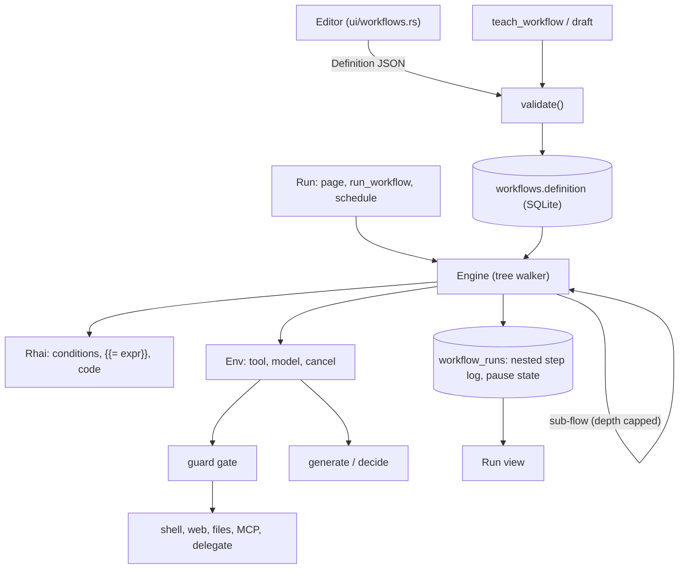

# Workflow builder

Agents run saved flows with branches, loops and fixed steps, so a model does not work out the same
job from scratch each time. You build and edit a flow by hand on the Workflows screen.

Status: agreed 2026-11-13. **Phase 1 built** (branches, loops, `set`, expressions, the editor); **P2 done** (`try`, MCP tools, taint tracking, `flow`, `delegate`; `http` was left out and is not planned); **P3 started** (`code`, the editor's test run, and `wait` and `parallel` built). Extends `src/workflow/` (see `workflow/mod.rs`); read that
first.

## What exists today

A workflow is a list of steps, learned from a chat (`teach_workflow`), saved with its agent, run from
the Workflows page or by an agent's `run_workflow`. Three step kinds: `tool`, `generate` (model
writes text), `decide` (model picks one of fixed options). Five tools: `shell`, web, `read_file`,
`write_file`, `edit_file`. A step that fails ends the run. References are `{{inputs.x}}` and
`{{bound.path}}`. Nothing branches or repeats, and there is no editor.

## Requirements

Functional

- Branch (`if`, `switch`), repeat (`for_each`, `while`), run branches at once (`parallel`), recover
  (`try` with retry and a catch path).
- Helper steps: `set` (build or reshape values), `code` (a script), `http`, `wait` (delay or
  approval).
- Tool steps may call the five current tools, any MCP tool the agent has, another saved workflow of
  the same agent (`flow` step), or hand a task to an agent (`delegate`).
- A visual editor: a stack of cards, one form per step, indented child lists inside containers,
  add / move / delete, a picker for earlier outputs, live validation.
- Started by you or by an agent's `run_workflow`. Schedules already target workflows
  (`docs/scheduler.md`) and need nothing new.
- Old workflows, and drafts learned from a chat, keep working and open in the editor.

Non-functional

- **Deterministic.** A model runs only in `generate`, `decide` and `delegate` steps, and the editor
  marks them. Everything else is the same on every run.
- **Safe unattended.** The same guard gate as agents (`docs/guardrails.md`). A bad definition is
  caught at save time; a run can fail only on data.
- **Bounded.** Every loop, script and run has a cap, so a flow cannot spin forever or eat memory.
- **Stoppable.** Stop works at once, inside loops, scripts, parallel branches and waits.
- **Observable.** A run shows each step as it ran, nested the way the flow is, with iteration
  numbers.
- **Survives the app closing** where it waits for you (approval), and says so where it cannot
  (everything else keeps today's "the app was closed" failure).

Out of scope: schedule or channel triggers inside a flow, a free node canvas, flows shared between
agents, flow versions and history.

## Architecture

The engine stays a pure function of a `Definition` and an `Env`, as now, so it is tested without a
network or shell. Control flow lives in the engine; effects live behind `Env`.

### Definition

Same JSON, `Step` stays one struct with a `kind` string and optional fields (stored definitions
parse unchanged). New kinds and fields, all optional:

| kind | fields | meaning |
|---|---|---|
| `if` | `cond`, `then`, `else` | run one child list |
| `switch` | `on`, `cases: [{when, steps}]`, `default` | first matching case; `default` if none |
| `for_each` | `over`, `as`, `steps`, `on_error` | binds a list of per-item results |
| `while` | `cond`, `steps`, `max` | repeats while true, at most `max` times |
| `parallel` | `branches: [{name, steps}]`, `on_error` | binds a map name → result |
| `try` | `steps`, `retries`, `backoff_ms`, `catch` | catch sees `error` |
| `set` | `values` | map of name → expression, bound as one object |
| `code` | `script`, `input` | Rhai script, returns a value |
| `http` | `method`, `url`, `headers`, `body` | returns status, headers, body |
| `wait` | `seconds` or `approve: "text"` | delay, or pause until you answer |
| `flow` | `workflow`, `inputs` | run a saved workflow of the same agent |
| `delegate` | `agent`, `task` | an agent does the task; its reply is the result |

`tool` steps gain MCP tools by name (`mcp__server__tool`). `bind` works on every kind. A container
sees everything bound before it plus, inside its body, `item`/`index` (for_each) or `error` (catch).
A name bound inside a body is visible only there; the container's own `bind` is what escapes.

### Expressions

One engine, Rhai, in three places:

- Condition fields (`cond`, `on`, `over`, `when`, `set` values) are Rhai expressions over the scope.
- Text fields keep `{{path}}` (path lookup, as now). `{{= expr }}` evaluates Rhai and inserts the
  result. No ambiguity with paths.
- `code` runs a script and returns a value.

Scope = `inputs`, each bound result by name, `item`/`index`/`error` where they exist, as Rhai
values converted from JSON. Rhai has no file, network or process access by default, and none is
added. Caps: operations, call depth, expression depth, string, array and map size, and a wall-clock
check through the progress callback, which also reads the stop flag. Expressions and scripts are
compiled at save time, so a syntax error is shown in the editor, not at run time.

### Run record

`StepLog` gains `path` (index trail, e.g. `2.then.0`) and `iteration`, both defaulted so old
records read unchanged. The log is flat and ordered; the run view indents by `path`. For long
loops, only the first and last iterations keep their full output, the rest keep status and a clipped
line (the 4000-character `KEEP` stays per step).

### Pausing (phase 3)

`wait` with approval saves the run's scope and cursor (`path`) and sets status `waiting`. The run
leaves its thread. It resumes when you answer on the Workflows screen, or after a restart, from the
saved cursor. Needs a migration: `workflow_runs.status` gains `waiting` (SQLite rebuilds the table to
change a CHECK), plus `state` and `waiting_for` columns. A timed `wait` under a few minutes just
sleeps on the run thread and fails on restart like any run; longer ones use the same save.

### Limits (defaults, all in one place)

| Limit | Value |
|---|---|
| Steps in a definition, nested counted | 50 |
| Nesting depth | 5 |
| `while` / `for_each` iterations | default 100, hard 1000 |
| Step executions in one run | 10 000 |
| `parallel` branches | 8 |
| Sub-flow depth | 5, and a flow may not reach itself |
| Rhai operations / one script's time | 1 000 000 / 10 s |

## Decisions

### ADR-1: Extend the existing definition

Status: accepted. Context: linear workflows are stored, taught from chat and run today. Decision:
add step kinds and optional fields to `Definition`; no new format. Alternatives: a graph format
with a migration (clean, but rewrites storage, teach and the engine at once); a separate feature
(two workflow concepts to explain). Consequences: old data needs no migration; `Step` grows many
optional fields (the cost of staying one struct); an older build rejects a new kind at validate.

### ADR-2: Nested tree, not a node graph

Status: accepted. Decision: containers own child step lists. Alternatives: free node graph. A tree
cannot loop back or fan in arbitrarily, which is the point: it always ends, joins are implicit, and
validation is a walk. The editor is a card stack, not a canvas. Consequences: patterns that need
`goto` are written with `while`. A graph view can render a tree later.

### ADR-3: Rhai for expressions and code

Status: accepted. Alternatives: a JS engine (QuickJS, Boa): familiar, heavy, harder to cap; a small
home-made condition DSL: too weak for the "full expression engine" asked for. Decision: Rhai, pure
Rust, no new native dependency (this app already fights for one SQLite), with limits set per
engine. One syntax for conditions, templates and the code node. Consequences: users learn Rhai
(small, JS-like); `{{path}}` remains the common easy case; scripts cannot do I/O, which is by
design, since I/O is a step the guard sees.

### ADR-4: The guard gate applies to every tool-like step

Status: accepted. Decision: `tool`, `http`, `delegate` and `flow` (its inner steps) go through the
same unattended gate and secret checks as agent calls. Values from web, MCP and `http` keep their
taint through `bind`, `set`, `code` and loops: a value derived from a tainted one is tainted, and a
tainted value reaching a gated action is handled as in a chat. `code` and `set` cannot launder
taint. Consequences: taint is tracked per bound result, not per field, which over-taints; that
errs on the safe side. Needs checking against `guard/taint.rs` when built.

### ADR-5: Results collect into lists and maps

Status: accepted. Decision: `for_each` binds an array of per-iteration results, `parallel` a map of
branch name → result. `on_error: stop` (default) ends the run at the first failure; `continue`
records the failure and puts `null` at that item or branch. Alternatives: side effects only
(forces `set` boilerplate). Consequences: a long loop's results live in memory for the run; the
caps above bound it.

### ADR-6: Waiting persists, everything else does not

Status: accepted. Decision: only `wait` with approval (and longer delays) is resumable. Other runs
keep today's "interrupted" failure on restart. Alternatives: persist every step (checkpointing
cost, replay of non-idempotent tools); live only (an approval would not survive a restart, which
defeats it). Consequences: a step in progress when the app closes is never replayed; a resumed run
continues after the `wait`, so the waiting step is the only checkpoint.

### ADR-7: Sub-flows and delegation stay inside the agent

Status: accepted. Decision: `flow` runs only a workflow of the same agent; `delegate` uses the
existing delegation. Recursion is rejected at save (static call chain) and capped at run time.
Consequences: a flow is a single-owner unit that goes and dies with its agent, as today. `delegate`
is the one non-deterministic tool step and is marked as such.

## Risks

| Risk | Mitigation |
|---|---|
| Runaway loop or script | Hard caps, progress-callback timeout, stop flag checked per step and per script operation block |
| Taint laundered through `set` / `code` | ADR-4; tested with a tainted web result reaching a gated shell step through each helper |
| Run view unreadable for big loops | Keep first/last iteration in full, fold the rest |
| Editor complexity | Cards and forms only; reuse existing form components; ship create/edit/validate before anything else |
| Resume after restart runs a stale scope | State saved at the `wait`; resume re-validates the definition and fails clearly if it changed |
| Rhai dependency surprises | Pin the version; engine behind one module so it can be swapped |
| Taught drafts stay linear | Accepted; `teach_workflow` is not asked to write control flow. Edit in the editor |

## As built in P1

- `while` runs its body first, then repeats while the condition holds, so the condition can read what
  the body bound (nothing else changes between rounds). A loop still true after `max` rounds fails
  the run rather than stopping quietly.
- `index` counts from 0; the run log's round numbers count from 1.
- `switch` compares by equality only (a whole number equals the same number written with a point).
- A `set` step's values each see what was there before it, not one another.
- The editor checks on adding, removing or moving a step, on Save, and on its Check button, not on
  every keystroke. Tool arguments are one JSON box. A chat draft is saved first, then edited.
- A step run more than five rounds keeps 200 characters of output instead of 4000.

## As built in P2

- `try`: `steps` is what is tried, `retries` (0 to 10) runs them again after a failure, `backoff_ms`
  (up to 60 000) waits between attempts and ends at once on Stop, `catch` runs when the last attempt
  fails and sees `error` (the failure's text). The `try`'s own `bind` is the body's last value, or
  the catch's. A stop is never caught. What the body or catch binds stays inside, as in other
  containers. Without a `catch`, the run ends at the step that failed, as without a `try`.
- MCP tools: a `tool` step may name any tool of an MCP server that is on (`mcp__server__tool`, as
  the MCP page and chats show it). A tool that is gone or whose server is off is said before the
  run starts. Sign-in tokens a call renews are saved when the run ends. A result is the server's
  text.
- Taint (ADR-4), as built: tracked by name for the whole run and never cleared. A tool result is
  outside text when `guard::taint::result_source` says so (web, MCP, and, in a folder that is not
  trusted, files and commands). A step's result is outside text if it is, or if the step reads a
  name that is. That covers `{{name}}` and every name in an expression, so `generate`, `set`,
  loops and `try`'s `error` carry it on and cannot launder it. A tool step that acts, and reads
  such a name or sits in a branch or loop chosen by one, is passed to the guard as acting after
  outside text: you are asked on a card, or the step is refused when nobody can be asked (a
  schedule). So a flow that fetches a page and then writes a file from it now asks first, where
  before it did not. Over-holding is possible (a name used in two places stays held, and words
  inside quotes in an expression count); under-holding is not known.
- `flow`: `workflow` is the name (any case) of another workflow of the same agent, `inputs` an
  object of values (text in them may use `{{...}}`), `bind` is required and holds the other
  workflow's last value. It runs inside the same run: same step count (10 000), same Stop, its steps
  shown nested under the card (`2.flow.0`). It sees only what it is given as `inputs`. A workflow
  may not run itself, even through others, and may be nested 5 deep. Saving refuses a missing or
  circular one, and a run checks before it starts (including the tools and MCP servers the other
  workflows use). Renaming or deleting a workflow another one runs is found when that one next
  runs or is saved, not at the moment. Outside text: the other workflow is held only if what it
  was given is outside text; what it fetches itself comes back as outside text as usual.
- `delegate` is a `tool` step with the tool `delegate` and arguments `agent` (a team member of the
  workflow's agent, fixed text, any case) and `task` (text; `{{...}}` allowed). The editor offers
  it only when the agent has a team. A member the workflow names is made ready before the run
  starts (so one that is not on the team, or has no model, is said up front). It takes the task as
  in a chat: fresh, with its own brief, model, tools and folder, unattended, up to 20 model calls.
  Stop ends it. The answer is the step's result, as text. Each task is filed as a run of the
  member's own under the Runs page. It goes through the guard like any acting step: if its task
  reads outside text, you are asked first, and the member then works with that outside text in
  view, so what it does is held too. Its answer counts as outside text if it wrote it with outside
  text in view. Cards it raises go where the workflow's do. A model writes the answer, so the
  step is not deterministic; the editor shows it as a tool step, with its agent and task.
## As built in P3

- `code`: `script` is a Rhai script over what is in scope (the same names as an expression sees).
  Statements, loops and functions are allowed; its last value is the result, bound as usual. Same
  sandbox and caps as expressions (1 000 000 operations, 10 s, Stop ends it); no files, network or
  programs. Saving compiles it and names the first problem; an undefined name is caught there.
  What it reads counts as the step's inputs for taint, so it cannot launder outside text. There is
  no `input` field: the script reads the values it needs by name.
- Test run: at the foot of the editor, with one box of `name = value` lines for the inputs (missing
  ones take their defaults). It runs the workflow as it stands in the editor, saved or not, after
  the same check as Save, and shows each step nested, as the run page does. It runs for real: the
  steps use the tools, MCP servers and team members, and the guard asks for a go-ahead on a card in
  the editor as it would anywhere. Nothing is saved, not the workflow and not the run; its model
  calls are counted in usage. Stop works; closing or saving the editor stops it and forgets it.
- `wait`: `seconds` (1 to 604 800, a week) or `approve` (text, `{{...}}` allowed), not both. Up to
  120 seconds is waited out where the run is, and Stop ends it. A longer delay, or any approval,
  pauses the run: it unwinds, each level leaving a frame (`workflow/pause.rs`: which step of which
  list, the loop's items and round and results so far, the `try`'s attempt, the branch taken, the
  `flow` it was in, and what was bound there), and the frames with the step log, usage and the names
  held as outside text make a snapshot. Resuming walks the frames back down, so steps before the wait
  never run again and the log keeps one line per step. Approved (or the delay over), the wait's
  value is `{approved: true}` or `{waited: n}`; declined, the step fails with "You declined this
  step.", which a `try` around it can catch. A wait inside a catch, loop, branch or another workflow
  works the same.
- Where a pause is kept: not in the run's status. SQLite cannot change a `CHECK` without rebuilding
  the table, and rebuilding `workflow_runs` would clear the links schedules keep to it. So a paused
  run stays `running` and has a row in `workflow_waits` (migration 023): the snapshot, what it
  asks, when a delay ends, and the steps it was running, so editing the workflow meanwhile does not
  change it. Start-up does not mark such a run as cut off, and the 30-day clean-up keeps it. Workflows
  it runs through `flow` are looked up as they are now; if one changed so that the saved position no
  longer fits, the run fails saying the workflow was changed.
- Answering: on the Workflows page a waiting run shows what it asks with Approve, Decline and Stop
  it (Go on now, for a delay). The half-minute tick goes on by itself with delays that are over.
  A run an agent or a schedule started tells them it paused and that what it makes later does not
  come back to them. A wait in the editor's test run stops the test there and says so. Model calls
  are counted for each stretch of a run, so a resumed run is not counted twice.
- `parallel`: `branches` is a list of up to 8, each a `name` (letters, digits, underscore, unique) and
  steps; `on_error` is `stop` (default) or `continue`. The branches run at once on their own threads
  and the step ends when all have. Its result is an object of branch name to that branch's last value
  (`null` for a branch that failed under `continue`, or that was stopped). Each branch starts from
  what is bound before the step, binds inside itself only, and cannot see its siblings. Under `stop`,
  the first failure ends the others before they start another step (a tool already running is not
  interrupted) and the run fails at that step. Stop ends all of them. The log lists the `parallel`
  line and then each branch's steps in the order the branches are written, with the branch's name in
  their path (`0.news.0`), so lines do not interleave by timing. Step counts, model use and held
  names from all branches are added to the run's. Outside text from any branch holds the whole
  result object, so a step reading even a clean branch's result is held. A wait that would pause the
  run (an approval, or more than 120 seconds) cannot be inside a branch: saving refuses it, and a
  workflow run through `flow` that does so fails at run time, since a pause needs one position to
  save. Short waits are fine. The engine's tools, model and workflow lookup now have to be safe to
  share between threads.

## Phases

**P1 — branching, loops, editor (built).** Rhai module and limits; `if`, `switch`, `set`, `for_each`,
`while`; `{{= expr}}`; nested validation; nested step log and run view; the editor (create, edit,
validate, delete, open a taught draft). No new tools.

**P2 — recovery and reach (built, except `http`, which was left out: a tool step can already fetch pages, and an MCP server covers other APIs).** `try` with retry and catch; `http`; MCP tools in `tool` steps;
`flow`; `delegate`.

**P3 — concurrency and humans (built).** `parallel`; `code`; `wait` with approval and persisted runs
(migration, pending list, resume); test-run from the editor with inputs and per-step output.

Each phase ships alone and leaves workflows that ran before running the same.

## Graph view

Status: designed 2026-11-14. **G1 and G2 built**; G3 not. A second view of the same editor state, for people who think
in boxes and wires. The card editor stays: it is the keyboard and screen-reader route, and the place
every box of a step is typed.

### What it is for, and what it is remembered by

One job: read a flow at a glance and rearrange it by hand without it turning into spaghetti. It is
not n8n's free graph (ADR-2 stands: a tree, so it always ends and a join is implicit). What makes it
ours, in order:

1. **Containers are frames.** `if`, `switch`, `for_each`, `while`, `try`, `parallel` and `flow` draw
   as a labelled frame holding their steps, so nesting is seen and not followed along wires.
2. **A model step looks different.** `generate`, `decide` and `delegate` have a dashed outline and a
   model glyph; everything else is solid. The deterministic/model line is the design's main promise,
   and it is drawn in shape, not only colour.
3. **A run paints onto the graph.** The step log is keyed by the same paths the graph uses, so a test
   run or a real run shows each node waiting, running, done or failed, with its output one click
   away, and a paused run shows where it waits.

### Layout (pure, in `workflow/layout.rs`, tested without a screen)

Steps flow top to bottom down one spine. A branching step puts its lists side by side as columns
(`then`/`else`, each `switch` case and `default`, each `parallel` branch), each column a spine of its
own, labelled on its first wire. A loop frame carries a return-arc glyph on its left edge, not a
wire. Wires are drawn between neighbours only, vertical, with a quad curve into a column; they are
never drawn by the person, so a loop back is not possible, and a join below a frame is implied by the
frame's end. Node 240 wide and 56 tall; 32 between steps; frame padding 16 and a 28 header; 24
between columns. A wide `switch` or `parallel` scrolls sideways; pan covers it.

### Interaction

- Select by click; the selected node's card form opens in an inspector on the right (the same form
  the card editor draws), so typing never happens on the canvas.
- Move by drag (once the pointer has gone about 3 pt a translucent copy follows it). Wires show an
  insertion line and a dot where it would land; frames that can take the step light up; the pointer
  says not allowed over the step's own frame. Dropping in the same view moves, Option copies. A drop
  that cannot land animates back. Every drag is undoable.
- Add: a `+` on each wire and on an empty frame, and the Add step button, open one searchable list of
  kinds, anchored where the step will go; its entries can also be dragged onto the canvas. There is
  no permanent palette column, so the canvas keeps its width.
- Keyboard, with no pointer: Tab enters the canvas; arrows move focus along the tree (up and down
  among siblings, right into a frame, left out); Enter opens the inspector; Option-up and Option-down
  move the step; `/` adds after the focused step; Delete removes. Ctrl-Z and Shift-Ctrl-Z undo and
  redo, with no limit on depth, naming what they reverse. A context menu on a node or wire repeats
  Add, Duplicate, Move up, Move down and Delete.
- Pan by dragging the background or the wheel; zoom with Ctrl-wheel or pinch, 70% to 140%. Below 85%
  a node drops its second line instead of shrinking text under 10 pt.
- Motion: the drag copy, a 120 ms settle on drop, and nothing else. With reduced motion it settles at
  once.

### Look (uses the kit's tokens, so light and dark both follow the desktop)

| Part | Token |
|---|---|
| Node fill, frame fill | `layer_01`, `layer_02` inside a frame |
| Node title, subtitle | `ui_medium` in `text_base`, `small` in `text_muted` (kit-tested at least 4.5:1; `text_faint` is only 3:1, so never for a node's own words) |
| Wire | 1.5 pt `border_strong`; 2 pt `bg_accent` when it touches the selection |
| Selected node | `layer_03` fill and a 2 pt `bg_accent` border |
| Keyboard focus | a separate 2 pt ring offset 2 pt, so focus and selection are not confused |
| Model step | dashed `border_strong` and a glyph |
| Problem | a warning glyph and the first problem as text under the title (`warning.icon` colour is not alone) |
| Run state | glyph and word: waiting, running, done, failed |
| Port, wire hit area | 8 pt drawn, 24 pt hit |

Controls are at least 28 by 28 pt, as on desktop. Each node reads to a screen reader as "Step 3 of 5:
For each name in files, holds 2 steps, problem: …"; wires are decorative.

### ADR-8: Draw the tree, own the layout

Status: accepted (design). Context: the ask was an n8n-style builder. Decision: draw the existing
tree as frames and spines, laid out by our own pure function, in Rune's canvas for wires and plain
elements for nodes; edit through the editor model's existing add, move and remove. Alternatives:
(a) a free node graph with new storage, engine and migration, rejected under ADR-2; (b) the kit's
mermaid renderer, which is static, has no hit testing and cannot nest live editing; (c) a graph view
only, rejected because a canvas alone is not reachable by keyboard or screen reader. Consequences: a
layout function and undo stack to write and test; wires cannot be drawn by hand; patterns that would
need a goto stay `while`.

### Phases

**G1 — see it.** `layout.rs` with tests; the graph view (nodes, frames, wires, pan, zoom); a
Cards/Graph switch; click to select with the inspector; keyboard focus and arrows. No editing on the
canvas yet beyond what the inspector does.

**G2 — move it.** Move, copy and insert by drag; the Add step list and `+` on wires; undo and redo;
context menu; Option-arrows and Delete.

**G3 — watch it.** Run state on nodes from the step log, live during a test run; problems shown on the
nodes; a paused run's wait highlighted with Approve and Decline on the node.

Left out on purpose: a minimap, colour per kind of step, a permanent palette column, drawn wires.

### As built in G1

- `workflow/layout.rs` is the pure layout and the arrow-key walk, with tests (no overlaps, every step
  inside its frame, the same steps always drawn the same, navigation across frames and columns).
  `flow_graph.rs` holds the view state and camera; `ui/workflow_graph.rs` draws it.
- The camera is Rune's own: two `Live` values under the drawing, so a wheel scroll or pinch moves it
  without the view running again. Middle-button and Space-drag panning, which Rune's canvas example
  has, are not wired yet; the wheel and pinch (Ctrl-wheel) are.
- A **Cards / Graph** switch sits by the title. It opens on Cards for now: in G1 the graph cannot add
  or move steps, so Cards stays the working view. G2 flips the default to Graph.
- Graph mode uses the whole window: the drawing, and a form column on the right. With a step selected
  the column is that step's own form (the card editor's, without the steps inside it, which are boxes
  on the canvas); with nothing selected it is the workflow's own: name, goal, agent, inputs, done-when,
  problems and test run. A switch's cases and a `parallel` step's branches are edited there too.
- Wires are drawn over the frames and under the steps. A step's way out of a frame goes straight down
  to a join line under the tallest column and then in to the middle, so a short column's wire never
  crosses the one beside it.
- Fit makes the drawing as big as fits the view, from full size down to 70%, centred if it fits and
  from its left edge if not; it runs by itself once, when the view first says how big it is, and on
  the Fit button. Below 85% a node drops its second line.
- One focus stop, not one per node: the canvas takes Tab once, and the arrows move the selection,
  which is the cursor (Escape clears it). This replaces the design's separate focus ring and
  selection on each node, which would have put every step in the Tab order. The canvas gets the ring.
- Not yet: dragging, the Add step list and `+` on wires, undo, the context menu, run state on nodes
  (all G2 and G3), and the 2 pt wire highlight beyond the selected step's own wires.

### As built in G2

- **Drag.** Press a step or frame and move more than 3 pt: it is dimmed where it was, a translucent
  copy follows the pointer by the spot it was held at, a 3 pt accent line shows the place between steps
  where it would land (an empty list's slot is outlined instead), and the frame that would hold it is
  outlined. Where it would stay, or outside every list, nothing is drawn and the drop does nothing.
  Release moves it; Option held at release leaves a copy (with new ids, and its results kept under
  `name_2`, `name_3`… so none is taken twice; a reference inside the copy to a name that was renamed
  shows as a problem to fix). Escape during a drag cancels. A step cannot be dropped inside itself:
  the lists inside it are not offered, so over its own columns it lands in the list around it.
  Dragging the background pans, as the wheel does. All of this is in `Layout::drop_target`, tested
  without a pointer.
- **Add.** The Add step button in the header opens the list of kinds and adds after the selected step
  (or at the end of the top list). A `+` also shows on the wires either side of the selected step, and
  an empty list's slot is itself the button. The `+` is not on every wire at once, so the drawing is not
  covered in buttons; and there is none before the first step of a frame, where the column's name is
  (drag a step there, or select the step and use Add step). The list is not searchable: with 13 kinds
  it is short.
- **Keys** (on the canvas): Delete or Backspace removes the step; Alt and an arrow moves it among its
  list; Ctrl-D copies it after itself; Ctrl-Z and Shift-Ctrl-Z (or Ctrl-Y) undo and redo; `/` opens
  the Add step list. A right-click on a step selects it and opens a menu: Duplicate, Move up, Move
  down, Delete, with the same shortcuts shown.
- **Undo** covers changes to the structure of the steps: add, delete, move, copy, a case or branch added
  or removed. It is a stack of the steps as they were, 200 deep, named ("Undo move step" on the button's
  hint), and a change after an undo ends the redo. Typing in a box is not on it (the box has its own
  undo), so undoing a change also takes back what was typed into the steps since it. Undo and Redo
  buttons sit in the header in both views.
- The form beside the graph is narrow, so the Id and result-name boxes sit under the step's name and its
  move and remove buttons instead of beside them.
- Still to do: run state on nodes and problems on nodes (G3); a search box in the Add step list; the
  graph as the default view, which waits for G3 so the first thing shown is the one that shows a run.

